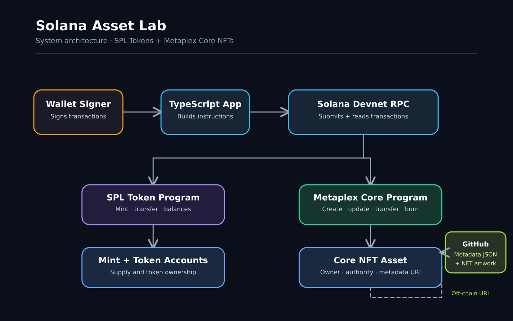

# Solana Asset Lab

A TypeScript project exploring fungible tokens and NFT lifecycle management on Solana, developed as part of the **Turbin3 Week 1 Assignment**.

The project implements SPL Token operations and Metaplex Core NFT creation, metadata updates, ownership transfers, and burning on Solana Devnet.

## Tech Stack

- TypeScript
- Solana Devnet
- @solana/web3.js
- @solana/spl-token
- Metaplex Umi
- Metaplex Core
- Node.js

## System Architecture



The architecture demonstrates how the TypeScript application interacts with Solana programs, on-chain accounts, and off-chain NFT metadata.

- **TypeScript Client:** Constructs and submits transactions.
- **Wallet:** Signs transactions and authorizes operations.
- **Solana RPC:** Connects the application to Solana Devnet.
- **SPL Token Program:** Handles fungible token minting and transfers.
- **Metaplex Core:** Manages NFT creation, metadata updates, ownership transfers, and burning.
- **Off-chain Metadata:** Stores NFT descriptions, attributes, and artwork.

## Assignment Completion

| Task | Description                                      | Status       |
| ---- | ------------------------------------------------ | ------------ |
| 1    | Mint and transfer an SPL token                   | ✅ Completed |
| 2    | Mint an NFT using Metaplex Core                  | ✅ Completed |
| 3    | Update NFT name and metadata as update authority | ✅ Completed |
| 4    | Transfer NFT ownership between wallets           | ✅ Completed |
| 5    | Burn an NFT and demonstrate rent recovery        | ✅ Completed |

Tasks 4 and 5 are optional extension challenges.

## Features

### 1. SPL Token Minting and Transfer

Created a fungible SPL token on Solana Devnet.

**Operations:**

- Create a new token mint
- Create an Associated Token Account (ATA)
- Mint 1,000 tokens
- Transfer 100 tokens to another wallet
- Verify token balances and total supply

**Results:**

| Metric             | Value |
| ------------------ | ----: |
| Minted supply      | 1,000 |
| Tokens transferred |   100 |
| Sender balance     |   900 |
| Recipient balance  |   100 |

**Mint Address:**

`8UeLzTVCiDS36niFCaSkgjSjrbivsNp9pruvGbtXnMQZ`

[View SPL Token](https://explorer.solana.com/address/8UeLzTVCiDS36niFCaSkgjSjrbivsNp9pruvGbtXnMQZ?cluster=devnet)

[View Transfer Transaction](https://explorer.solana.com/tx/2u2pqNppoxENbH432VYDYddRvuZ37FEQ4NMUzNR4jHXrRfh1J8VBXjx2fAvFavsV4SJo5rMoxYRTHjGnyHovAvh5?cluster=devnet)

### 2. NFT Minting with Metaplex Core

Created a Metaplex Core NFT named **Genesis**.

**Implementation:**

- Initialize Umi
- Configure the wallet signer
- Generate a unique asset keypair
- Create an NFT using MPL Core
- Attach an off-chain metadata URI
- Verify the created asset on Solana Devnet

**NFT Address:**

`3wziwmay3YzAFj1J6ssRA2TG8SFndBnZqhStzHxRiGWd`

[View Genesis NFT](https://explorer.solana.com/address/3wziwmay3YzAFj1J6ssRA2TG8SFndBnZqhStzHxRiGWd?cluster=devnet)

### 3. NFT Metadata Update

Updated the Genesis NFT using its update authority.

**Changes:**

- Original name: `Santhoshini Genesis`
- Updated name: `Genesis`
- Updated metadata URI to `genesis-v2.json`
- Preserved the original asset address

The update was authorized by the NFT's update authority and executed through the Metaplex Core program.

This demonstrates how NFT metadata can be updated without creating a new asset, provided the appropriate update authority is available.

### 4. NFT Ownership Transfer

Transferred ownership of Genesis between two Solana Devnet wallets.

**Transfer details:**

- Original owner: Primary wallet
- New owner: Recipient wallet
- NFT name and metadata remained unchanged
- The original Genesis asset address was preserved

This demonstrates how NFT ownership can change independently of the asset's identity.

[View NFT Ownership](https://explorer.solana.com/address/3wziwmay3YzAFj1J6ssRA2TG8SFndBnZqhStzHxRiGWd?cluster=devnet)

### 5. NFT Burning and Rent Recovery

Created a separate Metaplex Core NFT named **Burn Test** to demonstrate permanent asset destruction and rent recovery.

The original Genesis NFT was preserved.

**Burn Test Asset Address:**

`rcGAi7hECdpySR2qvoE25yxGy1YW7YjvsvyD15rgEdy`

**Results:**

| Metric                      |          Value |
| --------------------------- | -------------: |
| Account balance before burn | 0.00305956 SOL |
| Account balance after burn  | 0.00215532 SOL |
| Account balance reduction   | 0.00090424 SOL |
| Account data after burn     |         1 byte |

The burn instruction invalidated the NFT and reduced the asset account's stored data.

The reduction in account balance demonstrates the release of recoverable rent. A residual account balance remained under the Metaplex Core burn mechanism.

The Burn Test NFT used separate metadata and artwork to keep the original Genesis NFT intact.

[View Burned Asset](https://explorer.solana.com/address/rcGAi7hECdpySR2qvoE25yxGy1YW7YjvsvyD15rgEdy?cluster=devnet)

## Project Structure

```text
solana-asset-lab/
├── assets/
│   ├── genesis.png
│   ├── shinobu.png
│   └── solana-architecture.png
├── metadata/
│   ├── genesis.json
│   ├── genesis-v2.json
│   └── burn-test.json
├── src/
│   ├── spl-token.ts
│   ├── transfer-token.ts
│   ├── create-nft.ts
│   ├── update-nft.ts
│   ├── transfer-nft.ts
│   ├── create-burn-test.ts
│   └── burn-nft.ts
├── package.json
├── tsconfig.json
└── README.md
```

## Getting Started

### Prerequisites

- Node.js and npm
- Solana CLI
- A Solana Devnet wallet with test SOL

### Installation

Clone the repository:

```bash
git clone git@github.com:Santhoshini2989/solana-asset-lab.git
cd solana-asset-lab
npm install
```

Configure Solana Devnet:

```bash
solana config set --url devnet
solana balance
```

The example scripts use the Solana CLI keypair located at:

```text
~/.config/solana/id.json
```

**Security:** Never commit private keys, wallet keypair files, or recovery phrases.

### TypeScript Validation

Verify the TypeScript project:

```bash
npx tsc --noEmit
```

### Running the Scripts

**SPL Token Operations**

```bash
npx tsx src/spl-token.ts
npx tsx src/transfer-token.ts
```

**NFT Creation and Metadata Update**

```bash
npx tsx src/create-nft.ts
npx tsx src/update-nft.ts
```

**NFT Ownership Transfer**

```bash
npx tsx src/transfer-nft.ts
```

**NFT Burning**

```bash
npx tsx src/create-burn-test.ts
npx tsx src/burn-nft.ts
```

**Important:** These scripts submit real Devnet transactions. Some create new assets, transfer ownership, or permanently burn NFTs.

Do not run them blindly or repeatedly.

The existing asset addresses are specific to this assignment. Update the configuration and verify wallet ownership before reusing the scripts.

## Key Learnings

This project provided hands-on experience with fundamental concepts of Solana development:

- How Solana represents fungible tokens using Mint Accounts and Token Accounts
- How mint authorities control token issuance
- How Associated Token Accounts store token balances
- How SPL token transfers work between wallets
- How Metaplex Core represents NFTs using dedicated asset accounts
- How on-chain NFT accounts reference off-chain metadata
- How update authority differs from asset ownership
- How NFT ownership can be transferred between wallets
- How NFT burning invalidates an asset and releases recoverable rent
- How to build, execute, and verify Solana transactions using TypeScript

## Why This Matters

Token and NFT lifecycle management forms the foundation of many blockchain applications.

The concepts explored in this project can be applied to:

- Digital collectibles
- Tokenized assets
- NFT-based memberships
- Gaming assets
- Digital ownership systems
- On-chain asset management

Understanding how assets are created, updated, transferred, and destroyed provides a practical foundation for building applications on Solana.

## Network

All transactions were performed on **Solana Devnet** using test SOL.

No Solana Mainnet assets were created or transferred.

## References

- [Solana Documentation](https://solana.com/docs)
- [SPL Token Documentation](https://solana.com/docs/tokens)
- [Metaplex Core Documentation](https://www.metaplex.com/docs/smart-contracts/core)
- [Turbin3](https://turbin3.com)
